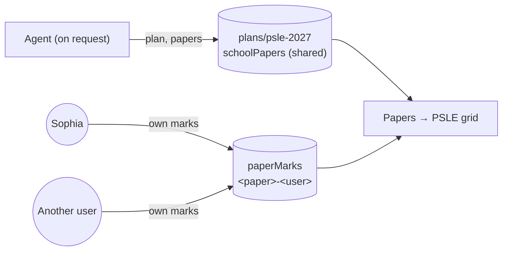

# 0051 Shared paper plan, adjustable new-per-week and a faster forecast

> status: completed (2026-11-25)
> location: branch `claude/dazzling-keller-aovz33`, baseline `ef11bec` (`develop`)
> confirmation: "Confirm and implement" (2026-11-25), confirming rows 1–12, Q1 A, Q1b C ("Yes, that switch"), Q3 A and every agent decision, and authorizing implementation in this session. Not covered (each needs its own confirmation): every production migration step (Q2m), any `ONLINE` deploy or release.

## Background and goal

The user reviewed the Plan feature of 0050 (released as release 97) and asked:

1. "For PSLE, should the plan of the PSLE papers be shared to everyone? And keep the history of each one."
2. "For 'questions per day', make the 'x new a week' adjustable with a forecast. And it feels lag when adjusting these numbers. Need improve."

- **Who:** Sophia (the actor), and anyone else who opens the arena (journey 0010).
- **Success:** (1) Everyone who opens Papers → PSLE sees the same plan of School papers, and each person's done marks and scores are kept separately. (2) In Settings, New per week can be adjusted next to Questions per day and the burndown redraws for it. Tapping − / + redraws the forecast at once, with no visible delay.
- **Non-goals:** changing paper selection, ranking, schedule order or PSLE date (0050 Q7, Q11, CF-1); changing how the forecast simulates the ladder (0050 Q5); limiting Today by either number.
- **Constraints:** production already holds `plans/u_NXoYbNGfkKlQUeHFusW3KQ` and 258 School papers whose ids and `for` field name Sophia (record/implement, first build of 2026-11-25). A shared plan changes `DATA.md`, ADR 0006 and the plan contract, and needs a confirmed production migration (Q17 of 0050 still applies: every production write is separately confirmed).

Affected: journeys 0015, 0016, 0006, 0014; `DATA.md` (`plans`, `schoolPapers`, `settings`); `model/arch/arena/SPEC.md` C7, C9, C11; `model/domain/DOMAIN.md`, `GLOSSARY.md`; `model/operate/plan/SPEC.md`, `model/operate/recover/SPEC.md`; ADR 0006.

## Target model

**Plan (Q1, Q2).** One shared Paper plan for PSLE 2027, `plans/psle-2027`. School papers become shared documents of that plan: ids `<plan id>-<subject>-<year>-<kind>-<school slug>`, a `plan` field instead of `for`, and the page subscribes `where('plan', '==', <plan id>)`. The page follows the plan whose `psleDate` is the earliest one not yet past. The grid opens on the viewer's own marks; when the Default owner is someone else, a "Mine · <owner>" switch shows that owner's marks read-only (Q1b). Each person's progress is a separate **Paper mark（做卷记录）** document `paperMarks/<paperId>-<userId>` with `paper`, `by`, `doneOn`, `score`, `total`. The page writes only the actor's own marks; the agent writes only the plan and papers. This keeps ADR 0006's one-writer-per-field split, and a re-plan cannot touch any mark.

**Forecast (Q3, Q4, Q5).** Settings gets a second stepper, **New per week**, under Questions per day. Unset shows the recent recording rate as a placeholder, as Questions per day does with recent pace. Changing either redraws the burndown and the finish line. Each tap redraws at once from local state and the save follows shortly after the last tap.

## Decisions for the user

**Q1 What "shared" means** (user decision 2026-11-25: "One plan, own marks" → A)

Today the plan belongs to one person (`plans/<user>`, `schoolPapers.for`), and anyone else sees "No plan yet" (0050 Q13).

| Option | Approach | Cost |
|---|---|---|
| A (recommended) | One plan for everyone. Each person who opens PSLE sees the same papers in the same weeks, and marks their own done date and score. The grid shows the viewer's own marks | Data change and a production migration (Q2) |
| B | Plans stay per person, but everyone can view Sophia's: the PSLE grid follows the Default owner, like the library and balance (0044); only the person the plan belongs to can mark | Smaller change; another student would still need their own plan built by the agent |

A matches "shared to everyone … keep the history of each one". Under A, a parent who only wants to watch Sophia's progress sees their own (empty) marks, so a follow-up is whether the grid should show the Default owner's marks read-only (Q1b, only if A).

**Q1b Whose marks the grid shows** (user decision 2026-11-25: "Two choices.", confirmed as C: "Yes, that switch")

| Option | Approach | Cost |
|---|---|---|
| A (recommended) | The viewer's own marks only | A parent cannot see Sophia's history on the grid |
| B | The Default owner's marks; mark/undo buttons appear only when that owner is the viewer | One more rule; matches how library, balance and This week already follow the owner |
| C (chosen) | Both: the grid opens on the viewer's own marks; when the Default owner is someone else, a two-way switch "Mine · <owner name>" shows that owner's marks read-only | One small switch; Mark done, Undo and Record mistakes appear only on "Mine" |

**Q3 Is New per week saved?** (user decision 2026-11-25: "Saved setting" → A)

The user asked for it to be "adjustable with a forecast". 0050 Q4a made it a fixed recent rate, "x is the single knob", which the user now reverses.

| Option | Approach | Cost |
|---|---|---|
| A (recommended) | Saved like Questions per day: `settings.newPerWeek` 0–100, absent = recent rate shown as placeholder; − / + stepper | One more stored field |
| B | What-if only: starts at the recent rate on each visit, not saved | Lost on reload; differs from Questions per day |

## Write-off plan
<!-- write-off -->

Journey and model changes only; `verify/` belongs to acceptance. Unchanged: selection, ranking, schedule order, PSLE date (0050 Q7, Q11), the forecast's ladder rules (0050 Q5), Today. Implementation updates `impl/arena.html`, `impl/logic.test.js`, `operate/plan/` (shared build and migration) and `operate/recover/backup.mjs`.

| # | Question | Target | Change | Verification | Actual result and verification |
|---|---|---|---|---|---|
| 1 | Q1, Q1b | `journey/0015-follow-psle-paper-plan.md` | Actor: any user; goal and success: one shared plan, each user's own marks and history; step 2 shows the viewer's marks; new extension: Default owner is someone else → "Mine · <owner>" switch, read-only view; 1a "no plan yet" means no shared plan exists; prerequisites: the shared plan built by 0016 | `./check.sh` || Applied (actor, prerequisites, success, step 2, 1a, new 2d, 2a, 6b); `./check.sh` passed |
| 2 | Q1, Q2, Q2m | `journey/0016-build-paper-plan.md` | Goal: one shared plan for everyone; steps write the shared plan and papers, never marks; new extension: migrate a per-user plan to the shared shape (backup, write, copy marks, read back, separately confirmed deletion of old documents); 6b: marks live in their own documents | `./check.sh` || Applied (goal, trigger, prerequisites, success, steps 3 and 6, 1b, new 1c, 6b); `./check.sh` passed |
| 3 | Q3, Q4, Q6 | `journey/0006-manage-settings.md` | Goal and step 2 add New per week (0–100); step 6: the forecast uses the set values; new extension 1c: New per week unset → recent recording rate shown in its place, never stored; step 3: − / + redraws the forecast at once and saves shortly after the last tap | `./check.sh` || Applied (goal, diagram step 2, steps 2, 3, 6, new 1c, 3a); `./check.sh` passed; Mermaid not validated (no integration) |
| 4 | Q1, Q2 | `model/domain/GLOSSARY.md` | Paper plan: shared by all users of the arena for one PSLE year; School paper: no owner, done marks moved out; new term Paper mark（做卷记录）: one user's done date and optional score for one School paper; new term New per week（每周新题）; User settings adds it | `./check.sh` || Applied (User settings, School paper, Paper plan, new Paper mark and New per week); `./check.sh` passed |
| 5 | Q1, Q2, Q3 | `model/domain/DOMAIN.md` | Aggregates: Paper plan (shared), School paper (agent only), new Paper mark (gateway via Papers, actor's own only); User settings adds New per week; Finish forecast and Plan progress inputs; invariant 12: the page writes only the actor's own Paper marks, the agent never writes marks; class diagram | `./check.sh`; Mermaid gap disclosed || Applied (aggregate table with Paper mark, class diagram, derived models, invariant 12); `./check.sh` passed; Mermaid not validated (no integration) |
| 6 | Q1, Q1b | `model/arch/arena/COMPONENT.md` | Line 3 adds `paperMarks`; Session subscribes to the shared plan, papers and the needed users' marks; Papers: owner switch; gateway: nine roots, Paper plan and School papers read-only | `./check.sh` || Applied (line 3, Session/settings, Papers, gateway nine roots, limits); `./check.sh` passed |
| 7 | Q1, Q1b, Q4 | `model/arch/SCENARIO.md` | S14: subscribe to the shared plan, papers and marks; mark/undo write the actor's Paper mark; owner switch read-only. S11: New per week; tap redraws locally, save follows | `./check.sh`; Mermaid gap disclosed || Applied (S11 note, S14 entry, diagram and closing note); `./check.sh` passed; Mermaid not validated (no integration) |
| 8 | Q1, Q1b, Q3–Q6 | `model/arch/arena/SPEC.md` | C11 inputs, writes (`paperMarks/<paper>-<actor>` only; Undo writes null fields), presentation (switch), failures (marks read failure ≠ no marks). C7: New per week input (set value or recent rate), finish line wording, redraw target 100 ms up to 1000 unmastered, identical output. C9: New per week saves like Questions per day; − / + redraw at once, write about 600 ms after the last tap, revert on failure | `./check.sh` || Applied (C7 New per week input, Forecast speed, Presentation; C9 delayed stepper write; C11 inputs, switch, writes, failures, boundary); `./check.sh` passed |
| 9 | Q2, Q3 | `DATA.md` | `plans/{计划 id}` (`psle-2027`), shared `schoolPapers` (ids `<plan id>-…`, `plan` field, subscription by `plan`; documents without `plan` are never shown), new `paperMarks/{学校卷 id}-{用户 id}` (`paper`, `by`, `doneOn`, `score`, `total`; validation as today), subscriptions and write split; `settings.newPerWeek` 0–100, absent = unset, never stores the placeholder | `./check.sh` || Applied (`settings.newPerWeek`, `plans/{计划 id}` and followed-plan rule, shared `schoolPapers` with `plan`, legacy note, new `paperMarks`, 加载 and write rules); `./check.sh` passed |
| 10 | Q2, Q2m, Q7 | `model/operate/plan/SPEC.md` | Build and re-plan the shared plan; ids prefixed by the plan id with a `plan` field; re-plan never moves papers of past weeks and checks every mark against the backup (Q7); never write `paperMarks` outside migration; new Migrate section (backup, write shared docs, copy marks, read back, each step confirmed, old documents deleted only on separate confirmation, page release after shared data exists) | `./check.sh` || Applied (trigger, authorization, data, build writes, re-plan rules and success, new Migrate section, recovery); `./check.sh` passed |
| 11 | Q2 | `model/operate/recover/SPEC.md`, `journey/0014-back-up-production-library.md` | Add `paperMarks` to the backed-up collections | `./check.sh` || Applied to both files; `./check.sh` passed |
| 12 | Q1, Q2 | `model/adr/0006-paper-plan-is-agent-curated-data.md` | Decision: one shared plan and papers written by the agent; per-user marks written by the page in their own documents; cost line "requested one by one" replaced | `./check.sh` || Applied in place (context, decision, rationale, cost); `./check.sh` passed |

## Evidence

### E1 Current plan ownership (primary)

- `DATA.md` `plans/{用户 id}` and `schoolPapers/{id}` with id `<用户 id>-<科目>-<年份>-<种类>-<学校简写>` and `for`; the page subscribes `where('for', '==', 本人)` and writes only `doneOn` / `score` / `total` on papers whose `for` is the actor.
- ADR 0006 cost: "Plans for other users must be requested one by one."
- Production (record/implement first build, 2026-11-25): 258 papers and one plan for Sophia; 129 scheduled over 43 weeks, 129 reserve.

### E2 The `db` has no atomic field update (primary: `DATA.md` handedIn rule)

- `handedIn` is updated by "读原值、加一项再写；并发用户交卷仍可能覆盖". A per-user map inside the shared paper document (`marks.<user>`) would have the same overwrite risk and would put page and agent writes on one document. Separate `paperMarks` documents avoid both.

### E3 Why adjusting feels slow (primary: `impl/arena.html`)

- `qpd-dec` / `qpd-inc` await `saveSettings`, which awaits the `db` write before `render()`, so every tap waits for a network round trip before anything changes on screen.
- `simulateFinish` filters and sorts every live exercise on every simulated day: 15 runs × 364 days × N log N. `render()` redraws the whole page and recomputes `recentPace` / `mine()` twice per redraw.
- Measured with the shipped `simulateFinish` in Node on the dev container (scratchpad bench, 2026-11-25; synthetic exercises, 78 % right):

| Unmastered | x a day | New a week | Shipped ms | Heap-based ms | Same output |
|---|---|---|---|---|---|
| 100 | 20 | 12 | 48 | 28 | yes |
| 300 | 20 | 20 | 181 | 25 | yes |
| 300 | 10 | 30 | 414 | 17 | yes |
| 600 | 30 | 40 | 589 | 61 | yes |
| 1000 | 40 | 60 | 1160 | 90 | yes |
| 300 | 10 | 100 | 982 | 27 | yes |
| 1000 | 10 | 100 | 1328 | 33 | yes |

- Inference: a phone or tablet is typically 2–5× slower than this container, so a backlog of a few hundred costs 0.5–2 s per tap plus the write. A priority queue ordered by (due day, id) pops the same exercises in the same order, so its output is identical (checked on all rows above) at 7–25× the speed.

### E4 Recording rate today (primary: `impl/arena.html` `recordRate`; `model/arch/arena/SPEC.md` C7)

- Exercises created in the selected library over the last 28 days ÷ 4, spread evenly over days. Shown only in the finish line, "with about N new a week".

## Carry-forward

- CF-1 open — Measure forecast redraw time on Sophia's device with her production backlog after implementation (target: about 100 ms from tap to redrawn chart; the number itself changes at once).
- CF-2 open — Before migration, count production School papers with `doneOn` set (likely zero: the plan was built on 2026-11-25) and report them with the migration rows.

## Agent decisions

**Q2 Shared data shape** (confirmed 2026-11-25; revised after review findings 3, 5, 7) `plans/psle-2027`; shared `schoolPapers` with ids `<plan id>-<subject>-<year>-<kind>-<school slug>` and a `plan` field (so a later plan cannot overwrite this one's weeks, and old user-prefixed documents, which have no `plan`, never show during migration); per-user `paperMarks/<paperId>-<userId>` with `paper`, `by`, `doneOn`, `score`, `total`. A missing mark or `doneOn: null` means not done; Undo writes the three fields as null (no delete). Validation as today. The page writes only marks whose `by` is the actor; the agent writes marks only in the migration (Q2m). Declined: a `marks` map inside each paper (E2); keeping the user-prefixed ids and ignoring `for` (misleading ids, and the agent's re-plan would still compute old-style ids).

**Q2m Migration** (confirmed 2026-11-25; revised after review finding 2; each production step needs its own confirmation) 1. Verified backup (0014). 2. Write the shared plan and papers (release 97 ignores them: it reads `plans/<user>` and `for`). 3. Copy Sophia's existing done marks into `paperMarks` (the one place the agent writes marks). 4. Release the page that reads the new shape. 5. Compare the old documents' marks with `paperMarks` again and copy any made in between. 6. Delete the 258 old documents and `plans/<Sophia>` only after a separate confirmation. Tooling delegated to implementation under the plan contract.

**Q4 Instant redraw, delayed save** (confirmed 2026-11-25) A tap on − / + updates the shown value and redraws only the forecast block from local state at once; the settings write follows about 600 ms after the last tap, and "Saved" shows when it is acknowledged. A failed write shows the error and reverts to the stored value. Typing in the box keeps the existing save on change. Declined: saving on every tap (E3).

**Q5 Faster simulation** (confirmed 2026-11-25; target revised after review finding 4) Keep the C7 rules and output; replace the per-day filter and sort with a priority queue by (due day, id), so results are identical (E3, including 100 new a week). The shown number changes at once on a tap whatever the redraw takes; C7 targets a redraw within about 100 ms on the user's device for her current backlog (CF-1), with unchanged inputs not recomputed. Data structure delegated to implementation. Declined: fewer runs (changes results) and a web worker (more code than needed once the simulation is fast).

**Q6 New per week range and wording** (confirmed 2026-11-25) 0–100 a week; a saved 0 is a value, not unset; label "New per week · recent N" with N the rounded recent rate, which is also where − / + start when unset; hint "Questions you expect to record each week." The finish line says "with N new a week" and drops "about" when the value is set.

**Q4b Delayed save details** (confirmed 2026-11-25, review finding 10) Taps on both steppers within the delay go out as one settings write; failure reverts both to the stored values. Leaving Settings sends a pending save at once. Another device's change replaces the shown values unless a save is pending, in which case the pending save wins. Batch size and Default owner keep saving on change (they are not steppers).

**Q7 Re-plan with shared papers** (confirmed 2026-11-25, review finding 1) A re-plan never changes the week of a paper in a week before the current one, whoever has done it; it re-spreads only the papers of the current and later weeks and the reserve, by rank. So each person keeps an unchanged history and their own "behind" papers. Old rule replaced: "done papers keep their week; unfinished ones move to reserve" (only meaningful for one owner). Success check: every `paperMarks` document equals the backup.

**Q8 Marks shown and their counts** (confirmed 2026-11-25, review findings 8, 9) The top line (done, behind) and the PSLE tab count use the marks shown (Mine, or the owner's view). Marks subscriptions for the owner view follow C1's reload generation when the Default owner changes. The PSLE marker in the forecast chart shows whenever a shared plan exists.

## Independent review (2026-11-25)

Reviewer: a fresh-context, read-only general-purpose sub-agent on Opus (the strongest available), given `assets/review-brief.md`. Verdict: "Reconsideration needed": re-plan and migration still assumed one owner per paper. Forecast half and journey tracing confirmed; `./check.sh` passes at baseline.

| Finding | Verification | Disposition |
|---|---|---|
| 1 reconsideration: re-plan "done papers keep their week" has no meaning with per-user marks | `model/operate/plan/SPEC.md` Re-plan rules | New Q7 (past weeks never move); row 10 and row 5 invariant |
| 2 reconsideration: marks written on old documents between copy and release are lost; agent copies marks despite "never writes marks" | Release 97 writes `doneOn` on `for` documents (`DATA.md` 学校卷 rule) | Q2m re-ordered with a second compare before deletion; migration exception stated; CF-2 |
| 3 reconsideration: new page would show old and new papers together | Both sets live in `schoolPapers` until deletion | Q2: `plan` field and `where('plan', …)` subscription |
| 4 reconsideration: 100 ms up to 1000 contradicts E3 phone estimate; 100 new a week unmeasured | Re-ran bench: 300/10/100 → 27 ms, 1000/10/100 → 33 ms, identical output | Q5 target restated for her backlog; the number updates at once; E3 extended |
| 5 alternative (all three thresholds hold): "one plan per year without reshape" was false | Ids lacked the plan | Accepted: plan id prefixes paper ids |
| 6 reconsideration: "Two choices." interpretation | User text | Asked at confirmation |
| 7 detail: Undo delete vs null | DATA.md is the sole data contract | Q2: null fields, absence = not done |
| 8 detail: subscription generation, counts | C1 reload rule | Q8 |
| 9 mechanical: PSLE marker wording | C7 Presentation | Q8, row 8 |
| 10 detail: stepper edge cases | `qpd-inc` rounds from recent pace | Q6, Q4b |

## Write-off result (2026-11-25)

- All 12 rows applied as planned; `./check.sh` passed. Changed Mermaid diagrams (journey 0006, DOMAIN class diagram, SCENARIO S14) were not machine-validated because no diagram integration is configured.
- Handoff: rows 1–12 and the current model go to implementation in this session (`impl/arena.html`, `impl/logic.test.js`, `operate/plan/`, `operate/recover/backup.mjs`). CF-1 and CF-2 pass to the implementation record. Production migration steps (Q2m) and any release each need separate confirmation.
